<!--
Copyright 2026 Google LLC

Licensed under the Apache License, Version 2.0 (the "License");
you may not use this file except in compliance with the License.
You may obtain a copy of the License at

    http://www.apache.org/licenses/LICENSE-2.0

Unless required by applicable law or agreed to in writing, software
distributed under the License is distributed on an "AS IS" BASIS,
WITHOUT WARRANTIES OR CONDITIONS OF ANY KIND, either express or implied.
See the License for the specific language governing permissions and
limitations under the License.
-->

# Domain Kits Visual Catalog

Browse all **153 curated styles & variants** across **57 watertight 2-manifold
parametric geometry constructors** in the **5 `three-live` Domain Kits**.

> **Interactive 3D Inspector:** Open the
> [**Live Domain Kits Catalog (`examples/kits/`)**](https://google.github.io/three-live/kits/)
> to toggle between **All Styles** and **Constructors (57)**, search across all
> kits, orbit/zoom every primitive at 60 fps in `<three-live>` Studio PBR, edit
> `<script type="text/three">` live, and export `.glb` / `.usdz` assets.

## Quick Jump

| Domain Kit                          | Namespace            | Bundle                               | Gzip   | Constructors | Visual |
:                                     :                      :                                      : Budget :              : Styles :
| :---------------------------------- | :------------------- | :----------------------------------- | :----: | :----------: | :----: |
| [**Mechanical                       | `THREE.Mechanical`   | `three-live-kit-mechanical.min.js`   | `< 18  | **15**       | **35** |
: CAD**](#mechanical-cad)             :                      :                                      : KB gz` :              :        :
| [**Architecture &                   | `THREE.Architecture` | `three-live-kit-architecture.min.js` | `< 16  | **9**        | **33** |
: AEC**](#architecture-aec)           :                      :                                      : KB gz` :              :        :
| [**Industrial & Process             | `THREE.Industrial`   | `three-live-kit-industrial.min.js`   | `< 14  | **10**       | **24** |
: Plant**](#industrial-process-plant) :                      :                                      : KB gz` :              :        :
| [**Science, Biology &               | `THREE.Science`      | `three-live-kit-science.min.js`      | `< 31  | **14**       | **32** |
: Math**](#science-biology-math)      :                      :                                      : KB gz` :              :        :
| [**Electronics &                    | `THREE.Electronics`  | `three-live-kit-electronics.min.js`  | `< 14  | **9**        | **29** |
: ECAD**](#electronics-ecad)          :                      :                                      : KB gz` :              :        :

> Load all 5 domain kits together via `three-live-kits.min.js` (`< 82 KB gz`),
> or load individual `three-live-kit-<domain>.min.js` bundles a la carte.

--------------------------------------------------------------------------------

## Mechanical CAD

**Namespace:** `THREE.Mechanical` · **Bundle:**
`three-live-kit-mechanical.min.js` (`< 18 KB gz`) · **Constructors:** 15 ·
**Styles:** 35

15 watertight 2-manifold machine elements: involute spur, bevel & internal ring
gears, racks, belt/timing pulleys, ISO metric bolts/nuts/washers, stepped
shafts, couplers, ball & pillow-block bearings, helical springs, weld-neck
flanges, and structural extrusions.

**Domain Helpers:**

-   `THREE.Mechanical.metricFastener('M8x25', scale?)` — ISO 4014 / 4762 / 4032
    thread, pitch, head, nut & washer lookup
-   `THREE.Mechanical.gearMeshDistance(gearA, gearB)` — Exact external &
    planetary internal center distance, ratio & phase offset

| Style 1                                                                                                                                                                                                    | Style 2                                                                                                                                                                                                  | Style 3                                                                                                                                                                                                   | Style 4                                                                                                                                                                                                         |
| :--------------------------------------------------------------------------------------------------------------------------------------------------------------------------------------------------------- | :------------------------------------------------------------------------------------------------------------------------------------------------------------------------------------------------------- | :-------------------------------------------------------------------------------------------------------------------------------------------------------------------------------------------------------- | :-------------------------------------------------------------------------------------------------------------------------------------------------------------------------------------------------------------- |
| 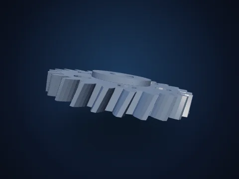 **`SpurGearGeometry`** 24T Helical + Hub                  | 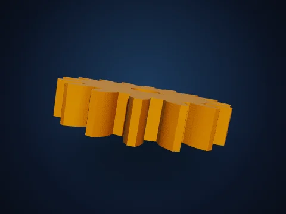 **`SpurGearGeometry`** 16T Straight Pinion         | 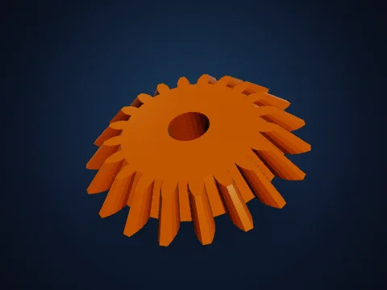 **`BevelGearGeometry`** 20T Miter Gear                    | 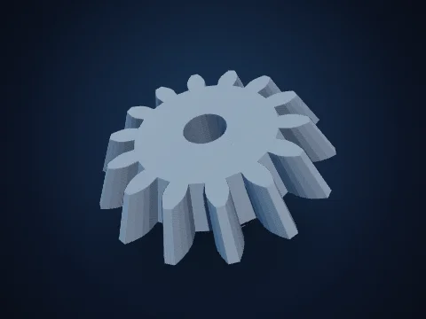 **`BevelGearGeometry`** 14T:28T Pinion                       |
| 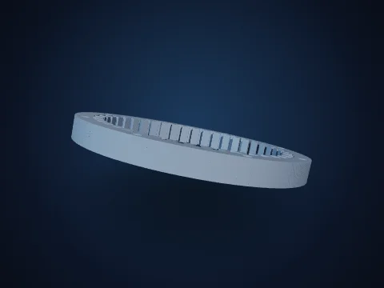 **`InternalRingGearGeometry`** 42T Planetary  | 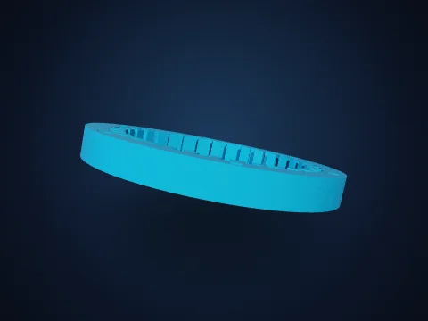 **`InternalRingGearGeometry`** 32T      | 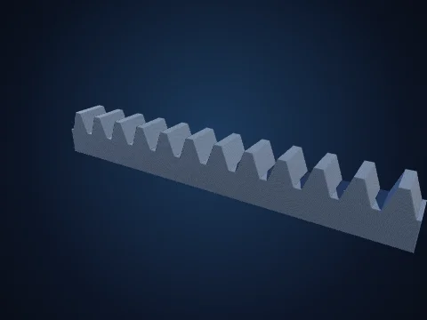 **`RackGeometry`** 12-Tooth Linear Rack                        | 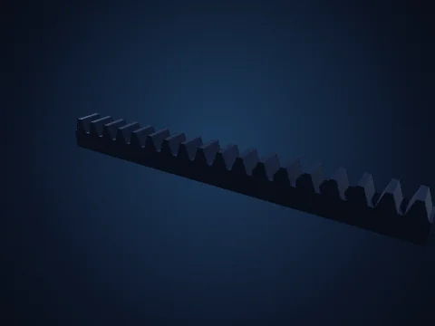 **`RackGeometry`** 18-Tooth Fine Pitch                             |
: Ring                                                                                                                                                                                                 : Compact Housing                                                                                                                                                                                    :                                                                                                                                                                                                           :                                                                                                                                                                                                                 :
| 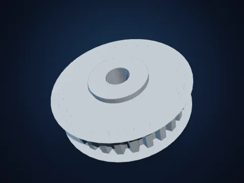 **`PulleyGeometry`** Toothed Timing Pulley                 |  **`PulleyGeometry`** Dual-Groove V-Belt                  | 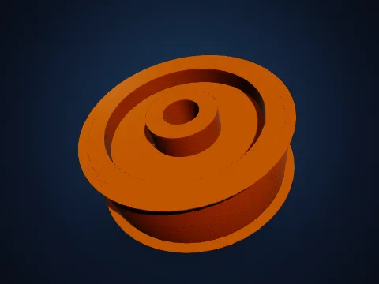 **`PulleyGeometry`** Flat Crowned Drum                     | 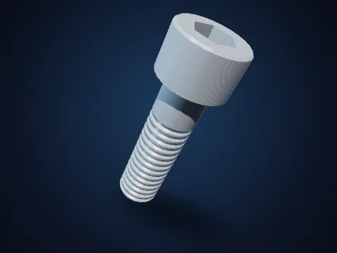 **`BoltGeometry`** Socket Cap M10×35                                    |
| 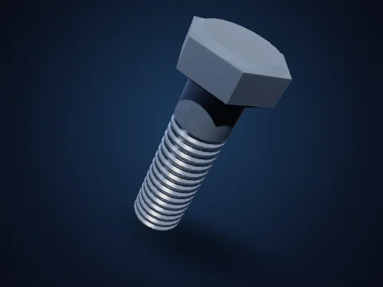 **`BoltGeometry`** Hex Bolt M12×40                                | 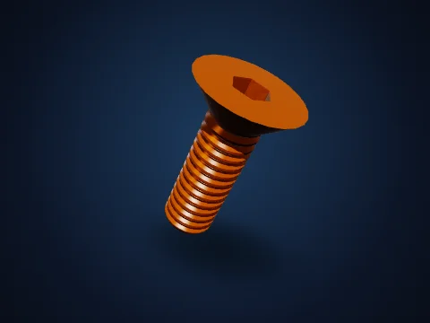 **`BoltGeometry`** Countersunk M8×25                          | 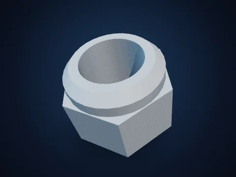 **`NutGeometry`** Nyloc Lock Nut M12                               | 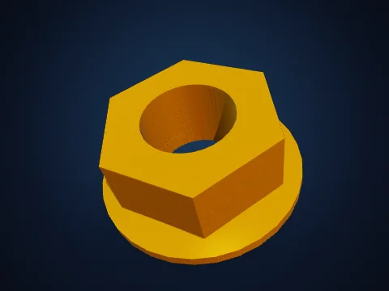 **`NutGeometry`** Flange Nut M10                                          |
| 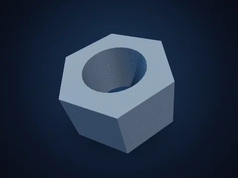 **`NutGeometry`** Standard Hex M12                                 | 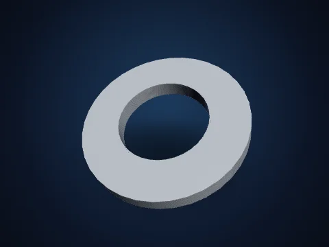 **`WasherGeometry`** Chamfered ISO M12                       | 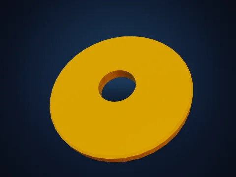 **`WasherGeometry`** Wide Fender Washer                   | 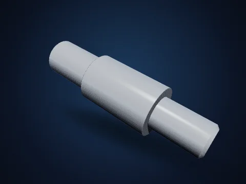 **`ShaftGeometry`** 3-Step CNC Drive Shaft                       |
| 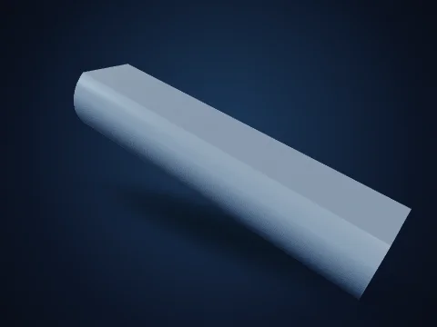 **`ShaftGeometry`** D-Cut Motor Shaft                         | 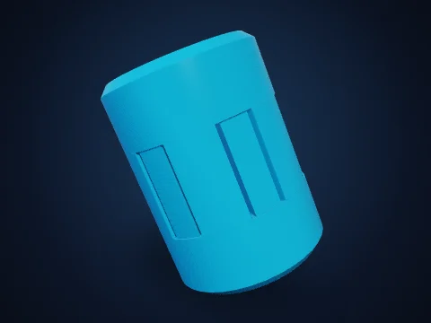 **`ShaftCouplerGeometry`** Jaw-Spider               | 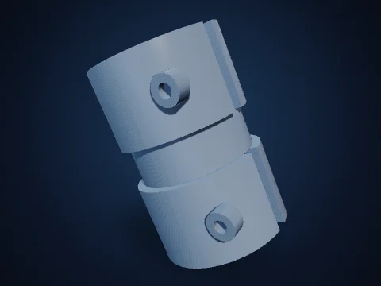 **`ShaftCouplerGeometry`** Rigid Split-Clamp  | 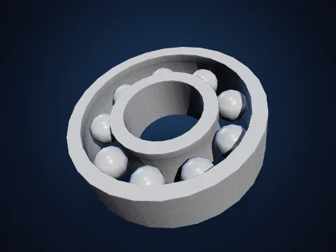 **`BearingGeometry`** Open Deep-Groove Bearing             |
:                                                                                                                                                                                                            : Coupling                                                                                                                                                                                           :                                                                                                                                                                                                           :                                                                                                                                                                                                                 :
| 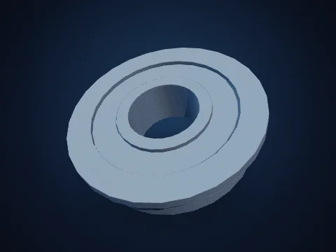 **`BearingGeometry`** Flanged Shielded Bearing     | 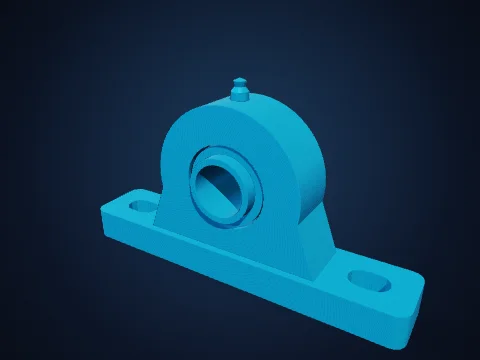 **`PillowBlockGeometry`** UCP Pedestal Bearing | 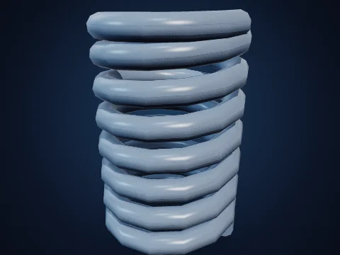 **`HelicalSpringGeometry`** 7-Coil           | 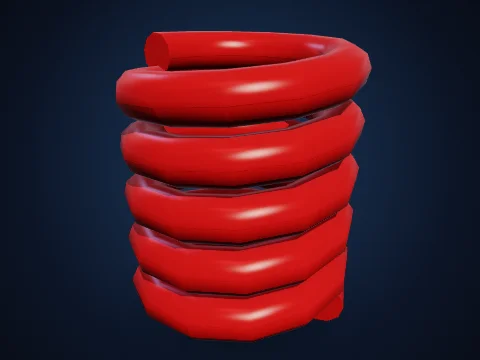 **`HelicalSpringGeometry`** Heavy 4.5-Coil Die  |
:                                                                                                                                                                                                            :                                                                                                                                                                                                          : Compression Spring                                                                                                                                                                                  : Spring                                                                                                                                                                                                    :
| 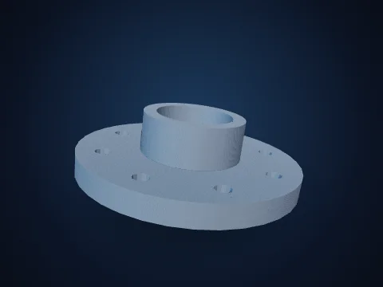 **`FlangePlateGeometry`** 8-Bolt Weld-Neck          | 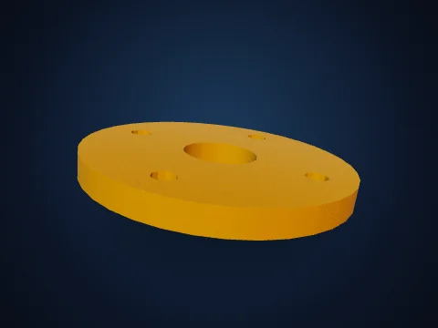 **`FlangePlateGeometry`** 4-Bolt Flat Plate    | 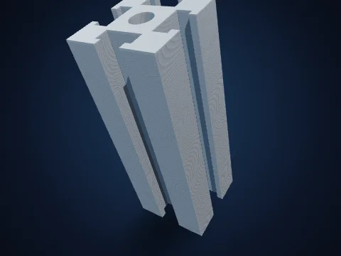 **`ProfileExtrusionGeometry`** T-Slot  | 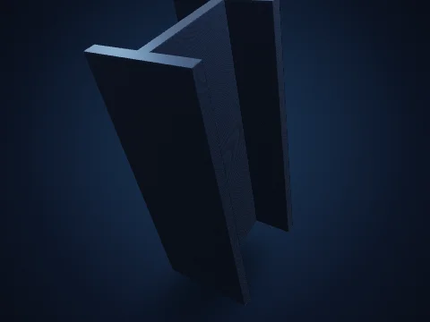 **`ProfileExtrusionGeometry`** Wide-Flange |
: Flange                                                                                                                                                                                               :                                                                                                                                                                                                          : Aluminum Extrusion                                                                                                                                                                                  : Steel I-Beam                                                                                                                                                                                              :
| 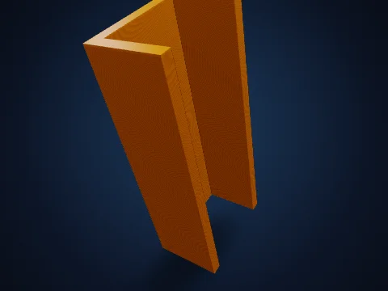 **`ProfileExtrusionGeometry`** Structural | 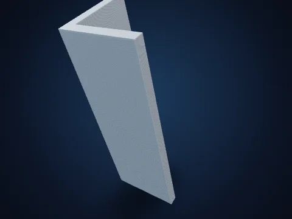 **`ProfileExtrusionGeometry`** L-Angle | 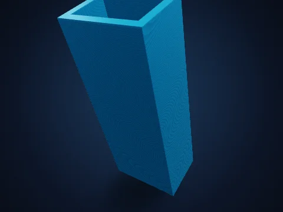 **`ProfileExtrusionGeometry`** Hollow |                                                                                                                                                                                                                 |
: C-Channel                                                                                                                                                                                            : Steel Bracket                                                                                                                                                                                      : Rectangular Tube                                                                                                                                                                                    :                                                                                                                                                                                                                 :

--------------------------------------------------------------------------------

## Architecture & AEC

**Namespace:** `THREE.Architecture` · **Bundle:**
`three-live-kit-architecture.min.js` (`< 16 KB gz`) · **Constructors:** 9 ·
**Styles:** 33

9 watertight 2-manifold building, BIM & interior elements: walls with
Roman/segmental/Gothic openings & moldings, floor slabs with stairwell/skylight
cutouts, IBC stairs, 6 roof styles, 10-style doors across 5 operations, 10-style
windows, guardrails, classical columns, and masonry archways.

**Domain Helpers:**

-   `THREE.Architecture.codeStairSpec(totalRise, opts?)` — IBC 7-11 compliant
    riser count, riser height, tread depth & slope calculator

| Style 1                                                                                                                                                                             | Style 2                                                                                                                                                                                     | Style 3                                                                                                                                                                                       | Style 4                                                                                                                                                                        |
| :---------------------------------------------------------------------------------------------------------------------------------------------------------------------------------- | :------------------------------------------------------------------------------------------------------------------------------------------------------------------------------------------ | :-------------------------------------------------------------------------------------------------------------------------------------------------------------------------------------------- | :----------------------------------------------------------------------------------------------------------------------------------------------------------------------------- |
| 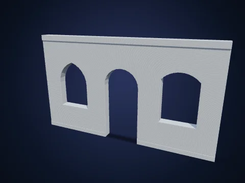 **`WallGeometry`** Arched Facade +     | 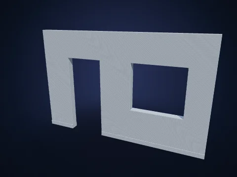 **`WallGeometry`** Interior Partition        | 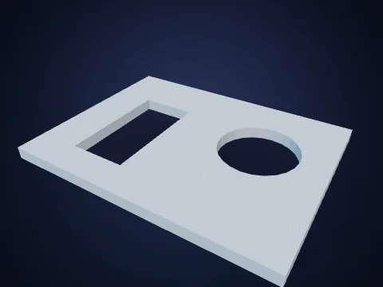 **`SlabGeometry`** Stairwell + Skylight      | 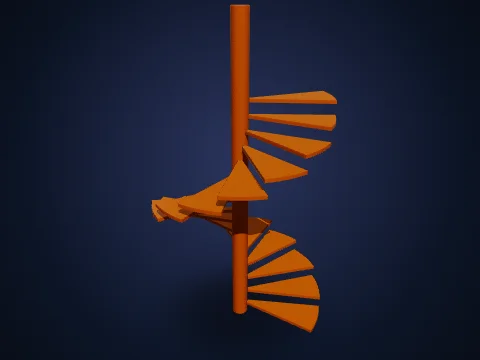 **`StaircaseGeometry`** Spiral  |
: Moldings                                                                                                                                                                      : Wall                                                                                                                                                                                  : Cutouts                                                                                                                                                                                 : Staircase                                                                                                                                                                :
| 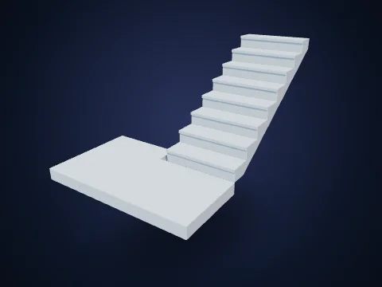 **`StaircaseGeometry`** U-Shape | 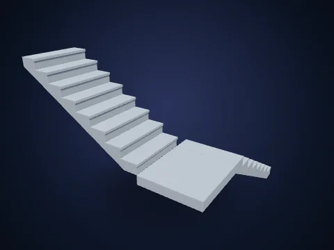 **`StaircaseGeometry`** L-Shape            | 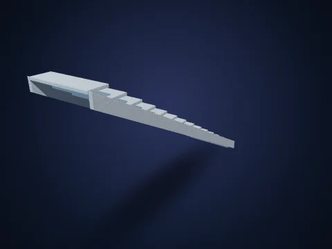 **`StaircaseGeometry`** Open-Stringer |  **`RoofGeometry`** Gambrel Vaulted   |
: Switchback                                                                                                                                                                    : Landing                                                                                                                                                                               : Straight                                                                                                                                                                                : Shell                                                                                                                                                                    :
|  **`RoofGeometry`** Hip Roof                   | 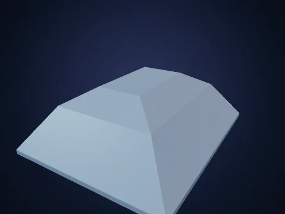 **`RoofGeometry`** Mansard Dual-Pitch       | 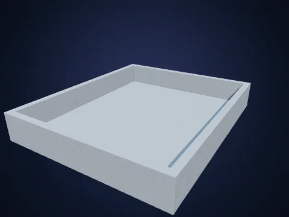 **`RoofGeometry`** Flat-Parapet                |  **`RoofGeometry`** Classic Gable     |
:                                                                                                                                                                                     :                                                                                                                                                                                             : Commercial                                                                                                                                                                              : Roof                                                                                                                                                                     :
| 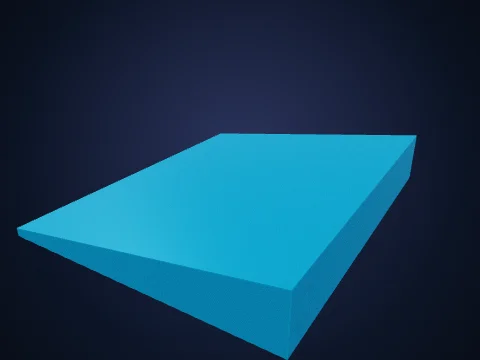 **`RoofGeometry`** Mono-Pitch Shed      | 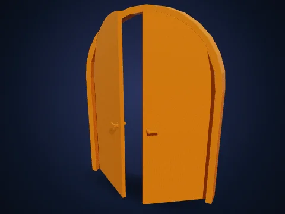 **`DoorGeometry`** Double Arched Swing   | 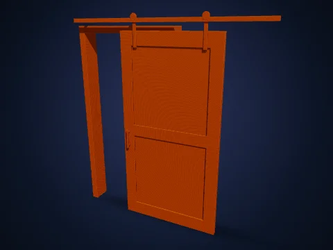 **`DoorGeometry`** Exposed-Rail Barn Door | 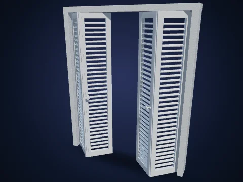 **`DoorGeometry`** 4-Leaf        |
: Roof                                                                                                                                                                          : (40% Open)                                                                                                                                                                            :                                                                                                                                                                                               : Louvered Bifold                                                                                                                                                          :
| 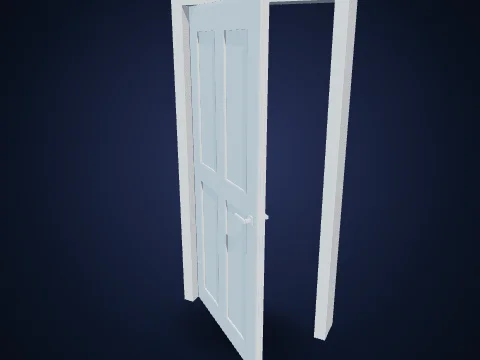 **`DoorGeometry`** 4-Panel Hinged       | 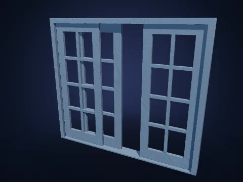 **`DoorGeometry`** OXO Sliding Patio          | 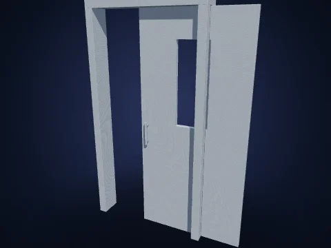 **`DoorGeometry`** Recessed Pocket Door     |  **`WindowGeometry`** Arched     |
: Swing                                                                                                                                                                         : Door                                                                                                                                                                                  :                                                                                                                                                                                               : Fanlight Window                                                                                                                                                          :
|  **`WindowGeometry`** Double       |  **`WindowGeometry`** Double-Hung Sash     |  **`WindowGeometry`** Top-Hinged Awning    |  **`WindowGeometry`** 3-Track |
: Casement (Open)                                                                                                                                                               :                                                                                                                                                                                             : Window                                                                                                                                                                                  : Sliding Window                                                                                                                                                           :
|  **`RailingGeometry`** IBC Baluster |  **`RailingGeometry`** Horizontal-Bar |  **`RailingGeometry`** Modern       |  **`ColumnGeometry`** Fluted    |
: Guardrail                                                                                                                                                                     : Cable Rail                                                                                                                                                                            : Infill-Panel Guardrail                                                                                                                                                                  : Classical Column                                                                                                                                                         :
|  **`ColumnGeometry`** Doric Order       |  **`ColumnGeometry`** Tuscan Order             |  **`ColumnGeometry`** Structural Steel    |  **`ArchwayGeometry`** Pointed  |
:                                                                                                                                                                                     :                                                                                                                                                                                             : H-Column                                                                                                                                                                                : Gothic Portal                                                                                                                                                            :
|  **`ArchwayGeometry`** Roman    |                                                                                                                                                                                             |                                                                                                                                                                                               |                                                                                                                                                                                |
: Semicircular Arch                                                                                                                                                             :                                                                                                                                                                                             :                                                                                                                                                                                               :                                                                                                                                                                                :

--------------------------------------------------------------------------------

## Industrial & Process Plant

**Namespace:** `THREE.Industrial` · **Bundle:**
`three-live-kit-industrial.min.js` (`< 14 KB gz`) · **Constructors:** 10 ·
**Styles:** 24

10 watertight 2-manifold process piping, factory & warehouse digital-twin
assets: 3D Bishop-frame flanged pipe runs, fittings, manual & pneumatic valves,
ANSI centrifugal pump skids, selective pallet racks, conveyors, OSHA catwalks,
caged ladders, safety barriers, and vessels.

**Domain Helpers:**

-   `THREE.Industrial.nominalPipeSpec('DN100' | '4in')` — ASME B36.10M / B16.5
    Class 150 pipe OD, wall & bolt-circle flange dimensions

| Style 1                                                                                                                                                                                   | Style 2                                                                                                                                                                                           | Style 3                                                                                                                                                                                      | Style 4                                                                                                                                                                                                    |
| :---------------------------------------------------------------------------------------------------------------------------------------------------------------------------------------- | :------------------------------------------------------------------------------------------------------------------------------------------------------------------------------------------------ | :------------------------------------------------------------------------------------------------------------------------------------------------------------------------------------------- | :--------------------------------------------------------------------------------------------------------------------------------------------------------------------------------------------------------- |
|  **`PipeRunGeometry`** 3D Z-Bend DN100          |  **`PipeRunGeometry`** U-Loop Manifold DN80   |  **`PipeFittingGeometry`** Flanged        |  **`PipeFittingGeometry`** Flanged 90° Elbow      |
: Run                                                                                                                                                                                 :                                                                                                                                                                                                   : Reducing Tee                                                                                                                                                                           :                                                                                                                                                                                                            :
|  **`PipeFittingGeometry`** 4-Way     |  **`PipeFittingGeometry`** Concentric |  **`ValveGeometry`** Rising-Stem Gate Valve    |  **`ValveGeometry`** Pneumatic Control Valve             |
: Flanged Cross                                                                                                                                                                       : Flanged Reducer                                                                                                                                                                             :                                                                                                                                                                                              :                                                                                                                                                                                                            :
|  **`ValveGeometry`** Quarter-Turn Ball        |  **`ValveGeometry`** Wafer Butterfly Valve        |  **`ValveGeometry`** Swing Check Valve           |  **`CentrifugalPumpGeometry`** 22 kW Process |
: Valve                                                                                                                                                                               :                                                                                                                                                                                                   :                                                                                                                                                                                              : Pump Skid                                                                                                                                                                                            :
|  **`PalletRackGeometry`** 2-Bay ×        |  **`ConveyorGeometry`** Live-Roller Conveyor    |  **`ConveyorGeometry`** Inclined Belt       |  **`CatwalkPlatformGeometry`** Dual-Guardrail |
: 3-Level Rack                                                                                                                                                                        :                                                                                                                                                                                                   : Conveyor                                                                                                                                                                               : Catwalk                                                                                                                                                                                              :
|  **`IndustrialLadderGeometry`** Caged    |  **`IndustrialLadderGeometry`** Uncaged Wall  |  **`SafetyBarrierGeometry`** Double |  **`SafetyBarrierGeometry`** Heavy Steel          |
: Access Ladder                                                                                                                                                                       : Ladder                                                                                                                                                                                      : Crash Guardrail                                                                                                                                                                        : Bollard                                                                                                                                                                                              :
|  **`StorageTankGeometry`** Vertical |  **`StorageTankGeometry`** Horizontal   |  **`StorageTankGeometry`** Cone-Hopper     |  **`StorageTankGeometry`** API 650 Flat-Bottom   |
: Dished on Legs                                                                                                                                                                      : Saddle Vessel                                                                                                                                                                               : Silo                                                                                                                                                                                   : Tank                                                                                                                                                                                                 :

--------------------------------------------------------------------------------

## Science, Biology & Math

**Namespace:** `THREE.Science` · **Bundle:** `three-live-kit-science.min.js`
(`< 31 KB gz`) · **Constructors:** 14 · **Styles:** 32

14 watertight 2-manifold chemistry, structural biology, crystallography, optics
& field-visualization primitives with end-to-end COLOR_0 & USDZ displayColor
scientific colormaps (viridis, plasma, turbo, coolwarm, inferno).

**Domain Helpers:**

-   `THREE.Science.elementSpec('Fe')` — 44-element IUPAC covalent/van-der-Waals
    radii & CPK color lookup
-   `THREE.Science.sampleColormap('viridis', t)` — Perceptually uniform RGB
    evaluation + colormapTexture & applyVertexColormap
-   `THREE.Science.ribbonColorMap(opts)` — 1D DataTexture ramp for N→C rainbow
    or secondary-structure polypeptide ribbons

| Style 1                                                                                                                                                                                                   | Style 2                                                                                                                                                                                                   | Style 3                                                                                                                                                                                      | Style 4                                                                                                                                                                                       |
| :-------------------------------------------------------------------------------------------------------------------------------------------------------------------------------------------------------- | :-------------------------------------------------------------------------------------------------------------------------------------------------------------------------------------------------------- | :------------------------------------------------------------------------------------------------------------------------------------------------------------------------------------------- | :-------------------------------------------------------------------------------------------------------------------------------------------------------------------------------------------- |
|  **`MoleculeGeometry`** Caffeine (Ball & Stick CPK)    |  **`MoleculeGeometry`** Benzene Aromatic Ring             |  **`MoleculeGeometry`** Ethanol              |  **`RibbonGeometry`** β-Hairpin + α-Helix         |
:                                                                                                                                                                                                           :                                                                                                                                                                                                           : (Space-Filling VdW)                                                                                                                                                                    : (Spectrum)                                                                                                                                                                              :
|  **`RibbonGeometry`** Secondary-Structure Palette       |  **`CrystalLatticeGeometry`** Perovskite +  |  **`CrystalLatticeGeometry`** Diamond |  **`CrystalLatticeGeometry`** Bilayer |
:                                                                                                                                                                                                           : (111) Miller Plane                                                                                                                                                                                  : Cubic (2×2×2)                                                                                                                                                                          : Graphene Sheet                                                                                                                                                                          :
|  **`CrystalLatticeGeometry`** Rock-Salt NaCl      |  **`AtomicOrbitalGeometry`** 3dz² Lobes + Nodal      |  **`AtomicOrbitalGeometry`** 3dx²−y²       |  **`AtomicOrbitalGeometry`** 2pz Dumbbell   |
: Lattice                                                                                                                                                                                             : Torus                                                                                                                                                                                               : Cloverleaf                                                                                                                                                                             :                                                                                                                                                                                               :
|  **`OpticalElementGeometry`** Biconvex Optical        |  **`OpticalElementGeometry`** Dispersive    |  **`SurfacePlotGeometry`** Sinc Wave             |  **`SurfacePlotGeometry`** Monkey Saddle  |
: Lens                                                                                                                                                                                                : Equilateral Prism                                                                                                                                                                                   : (Viridis)                                                                                                                                                                              : (Coolwarm)                                                                                                                                                                              :
|  **`ParametricSurfaceGeometry`** Spherical |  **`ParametricSurfaceGeometry`** (2, 3) |  **`VectorFieldGeometry`** Magnetic       |  **`VectorFieldGeometry`** Swirling Helical |
: Harmonic (Turbo)                                                                                                                                                                                    : Torus Knot (Plasma)                                                                                                                                                                                 : Dipole Glyph Grid                                                                                                                                                                      : Field                                                                                                                                                                                   :
|  **`IsoSurfaceGeometry`** Gyroid TPMS (Viridis)          |  **`IsoSurfaceGeometry`** Schwarz-P Minimal             |  **`IsoSurfaceGeometry`** Metaball Cluster    |  **`StreamlineGeometry`** Magnetic Dipole    |
:                                                                                                                                                                                                           : Surface                                                                                                                                                                                             :                                                                                                                                                                                              : Streamlines                                                                                                                                                                             :
|  **`StreamlineGeometry`** Lorenz Strange Attractor |  **`Axes3DGeometry`** Symmetric ±XYZ Frame + Ticks       |  **`Axes3DGeometry`** Positive Octant XYZ         |  **`DoubleHelixGeometry`** 2.4-Turn B-DNA |
:                                                                                                                                                                                                           :                                                                                                                                                                                                           :                                                                                                                                                                                              : Double Helix                                                                                                                                                                            :
|  **`DashedLineGeometry`** 3D Optical Ray-Trace Path |  **`DashedLineGeometry`** Flat-Cap H-Bond Triad      |  **`AngleArcGeometry`** 104.5° H–O–H Bond      |  **`AngleArcGeometry`** 90° Perpendicular |
:                                                                                                                                                                                                           :                                                                                                                                                                                                           : Angle Arc                                                                                                                                                                              : Square Elbow                                                                                                                                                                            :

--------------------------------------------------------------------------------

## Electronics & ECAD

**Namespace:** `THREE.Electronics` · **Bundle:**
`three-live-kit-electronics.min.js` (`< 14 KB gz`) · **Constructors:** 9 ·
**Styles:** 29

9 watertight 2-manifold PCB & hardware enclosure primitives: rounded FR4 boards
with mounting holes, flanged/vented enclosures with I/O cutouts, tapered-fin
heatsinks, IEC DIN rails, JEDEC IC packages, pin headers, USB-C/RJ45/HDMI/SMA
connectors, standoffs, and discrete passives.

**Domain Helpers:**

-   `THREE.Electronics.jedecPackageSpec('LQFP-64', scale?)` — JEDEC / IPC body,
    pitch & lead-span table for DIP, SOIC, QFP, QFN, BGA, TO-220 & D2PAK

| Style 1                                                                                                                                                                                                     | Style 2                                                                                                                                                                                                              | Style 3                                                                                                                                                                                                    | Style 4                                                                                                                                                                                                      |
| :---------------------------------------------------------------------------------------------------------------------------------------------------------------------------------------------------------- | :------------------------------------------------------------------------------------------------------------------------------------------------------------------------------------------------------------------- | :--------------------------------------------------------------------------------------------------------------------------------------------------------------------------------------------------------- | :----------------------------------------------------------------------------------------------------------------------------------------------------------------------------------------------------------- |
|  **`PcbBoardGeometry`** 85×56 mm SBC Carrier           |  **`PcbBoardGeometry`** Circular Sensor                   |  **`EnclosureGeometry`** Vented Base + Bosses &  |  **`EnclosureGeometry`** Closed Flanged Wall Box |
: Board                                                                                                                                                                                                 : Daughterboard                                                                                                                                                                                                  : Cutouts                                                                                                                                                                                              :                                                                                                                                                                                                              :
|  **`HeatsinkGeometry`** 13-Fin Anodized Heatsink    |  **`HeatsinkGeometry`** Silver Extruded Heatsink          |  **`DinRailGeometry`** Slotted TS35×7.5 Rail           |  **`DinRailGeometry`** Deep TS35×15 Top-Hat Rail  |
|  **`IcPackageGeometry`** LQFP-64 Microcontroller  |  **`IcPackageGeometry`** DIP-16 Through-Hole IC          |  **`IcPackageGeometry`** TO-220 Power MOSFET      |  **`IcPackageGeometry`** BGA-64 Ball-Grid            |
:                                                                                                                                                                                                             :                                                                                                                                                                                                                      :                                                                                                                                                                                                            : Package                                                                                                                                                                                                :
|  **`IcPackageGeometry`** SOIC-8 Gull-Wing IC       |  **`IcPackageGeometry`** D2PAK Surface-Mount Power    |  **`PinHeaderGeometry`** 2×8 Shrouded IDC Box      |  **`PinHeaderGeometry`** 1×8 Right-Angle Male       |
:                                                                                                                                                                                                             :                                                                                                                                                                                                                      : Header                                                                                                                                                                                               : GPIO                                                                                                                                                                                                   :
|  **`ConnectorGeometry`** USB-C Receptacle                 |  **`ConnectorGeometry`** RJ45 Ethernet Jack                   |  **`ConnectorGeometry`** 4-Pole Screw Terminal   |  **`ConnectorGeometry`** SMA RF Coax Bulkhead       |
:                                                                                                                                                                                                             :                                                                                                                                                                                                                      : Block                                                                                                                                                                                                :                                                                                                                                                                                                              :
|  **`ConnectorGeometry`** HDMI Type-A Receptacle  |  **`ConnectorGeometry`** DC Barrel Power Jack               |  **`StandoffSpacerGeometry`** M3 Brass      |  **`StandoffSpacerGeometry`** M4 Cylindrical  |
:                                                                                                                                                                                                             :                                                                                                                                                                                                                      : Male-Female Hex                                                                                                                                                                                      : Spacer                                                                                                                                                                                                 :
|  **`DiscreteComponentGeometry`** 6×6 |  **`DiscreteComponentGeometry`** Radial |  **`DiscreteComponentGeometry`** 5 |  **`DiscreteComponentGeometry`** HC-49U |
: mm Tactile Push Switch                                                                                                                                                                                : Electrolytic Capacitor                                                                                                                                                                                         : mm Domed Indicator LED                                                                                                                                                                               : Quartz Crystal                                                                                                                                                                                         :
|  **`DiscreteComponentGeometry`** 0805  |                                                                                                                                                                                                                      |                                                                                                                                                                                                            |                                                                                                                                                                                                              |
: SMD Chip Passive                                                                                                                                                                                      :                                                                                                                                                                                                                      :                                                                                                                                                                                                            :                                                                                                                                                                                                              :
